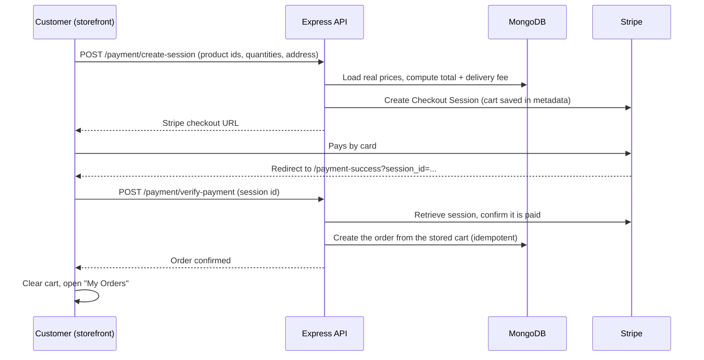

# 🛒 FreshMart

<p align="center">
  
</p>

**A full-stack grocery and lifestyle e-commerce platform built for Nigeria.**
Customers browse, search, build a cart, pay by card or cash on delivery, and track their orders. Store admins manage the catalogue, orders and revenue from a dedicated dashboard.


---

## Table of contents

1. [Overview](#overview)
2. [Features](#features)
3. [What makes it stand out](#what-makes-it-stand-out)
4. [Tech stack](#tech-stack)
5. [Architecture](#architecture)
6. [How checkout works](#how-checkout-works)
7. [API reference](#api-reference)
8. [Getting started](#getting-started)
9. [Environment variables](#environment-variables)
10. [Testing payments](#testing-payments)
11. [Security](#security)
12. [Deployment notes](#deployment-notes)
13. [Roadmap](#roadmap)
14. [Author](#author)

---

## Overview

FreshMart is made of **three apps** that work together:

| App | Folder | Purpose | Default port |
|---|---|---|---|
| **API** | `backend/` | Express + MongoDB REST API, payments, email, image uploads | `8000` |
| **Storefront** | `frontend/` | The customer-facing shop (Next.js) | `3000` |
| **Admin panel** | `admin/` | Dashboard for managing products, orders and revenue (Next.js) | `3001` |

It is built around Nigerian realities: prices in **Naira (₦)**, **Nigerian phone number** formats (`080…` and `+234…`), address fields that make sense for Lagos and beyond, and delivery fees controlled by the shop owner.

> 📸 **Screenshots:** add images of the storefront, cart, orders page and admin dashboard here (for example in a `docs/` folder).

---

## Features

### 🛍️ Customer storefront

**Shopping**
- Home page with a banner, category grid, and a "Signature Hookah Picks" section
- **Live search** across products *and* hookahs by name, company, category or size, with multi-word matching ("milk peak" finds "Peak Milk")
- Category pages and product cards with discount-aware pricing (the old price is only struck through when there really is a discount)
- Add to cart straight from product cards, with quantity controls

**Cart**
- Cart persists in the browser, so it survives refreshes and stays in sync across open tabs
- Quantity limits that match what the server accepts
- Safe loading with no "empty cart" flash on page load

**Accounts & authentication**
- Sign up with **email OTP verification**
- Login, with automatic re-sending of a verification code for accounts that aren't verified yet
- **Forgot / reset password** through a 6-digit emailed code
- Resend-code button with a **60-second countdown**
- "Redirect after login": customers who are sent to log in return to the page they came from

**Delivery addresses**
- Save multiple addresses (Home, Office, Other), edit them, and pick one for delivery
- Nigerian phone validation, optional postal code
- The chosen address is remembered and used at checkout

**Checkout & payments**
- **Cash on Delivery** or **online card payment** through Stripe Checkout (NGN)
- Order total, prices and delivery fee are always calculated by the server
- Clear success and cancel pages; the cart is cleared **only after payment is verified**

**Orders**
- Order history with status badges, payment status, itemised summary and progress tracker
- Customers can cancel orders that are still *Processing* and unpaid; other orders show why they can't be cancelled

### 🧑‍💼 Admin panel

- **Admin-only access**: role-checked on the API, plus route protection in the app
- **Dashboard**: total revenue, active / delivered / cancelled orders, product and category counts, latest orders
- **Order management**
  - Server-side **search, status filter and pagination**
  - Update status (Processing → On the way → Delivered, or Cancelled) from a dropdown or the details modal
  - Order details modal with customer info, delivery address, itemised products and a status timeline
  - Confirmation step before cancelling
- **Catalogue management**
  - **Categories:** create, rename, change image, delete. Renaming updates every product in it; a category that still has products can't be deleted
  - **Products:** create, edit, delete, with image upload
  - **Hookahs:** the same full management for the hookah range
- **Image uploads to Cloudinary** with type and size checks, instant previews, and automatic clean-up of replaced images

### 🔧 Backend

- REST API with clean controllers, shared error handling and consistent JSON responses
- JWT authentication, role-based authorisation, rate limiting
- Transactional emails through Brevo (verification and password-reset codes)
- Stripe Checkout integration with verified, idempotent order creation
- Cloudinary image storage

---

## What makes it stand out

### 1. The server decides the price, always
The browser only ever sends **product IDs and quantities**. The API looks up the real names and prices in the database, adds the delivery fee, and calculates the total itself. Nobody can change what they pay by editing a request, for cash on delivery *or* online payments.

### 2. Payments that survive real-world behaviour
- The cart is stored inside the Stripe session, so the order is built from what the **server** saved, never from what the browser says afterwards
- The order total equals what Stripe actually charged
- Refreshing the success page or verifying twice can't create duplicate orders (a unique index plus an idempotent check)
- If a customer abandons Stripe, nothing is lost: the cart stays put

### 3. Order history that never lies
Every order keeps a **snapshot** of each item's name, image, size and price at the time of purchase, plus a snapshot of the delivery address. Changing a price, renaming a product or editing a saved address later never rewrites past orders, and deleting a product doesn't break order history.

### 4. Built-in protection against common attacks
Ownership checks on orders, addresses and cart items, admin-only write routes, NoSQL-injection guards, HTML-escaped emails, pinned JWT algorithm, rate-limited auth routes and hardened uploads. See [Security](#security).

### 5. OTP flows done properly
Codes come from a cryptographically secure generator, are **stored hashed**, expire in 10 minutes, allow only **5 attempts** (counted atomically so parallel guessing can't bypass it), and enforce a **60-second resend cooldown**. Forgot-password never reveals whether an email is registered.

### 6. Made for Nigeria
₦ formatting, NGN checkout, local phone normalisation (`+234…`, `234…` and `0…` are treated as the same number, so one person can't register twice), optional postal codes, and a shop-controlled delivery fee.

### 7. Admin tools that scale
The orders page searches and paginates **in the database**, not in the browser, so it stays fast as order volume grows. Dashboard revenue uses a database aggregation.

### 8. Polished UX details
Debounced search, redirect-after-login, saved delivery address, resend countdowns, disabled buttons during requests, toasts with the server's real error messages, empty and loading states everywhere, and accessible labels and dialogs.

---

## Tech stack

| Layer | Technology |
|---|---|
| **Storefront & Admin** | Next.js (App Router), React, Tailwind CSS, Axios, Lucide icons |
| **API** | Node.js, Express |
| **Database** | MongoDB with Mongoose |
| **Auth** | JSON Web Tokens (HS256), bcrypt |
| **Payments** | Stripe Checkout (NGN) |
| **Email** | Brevo transactional email API |
| **Images** | Cloudinary, Multer for temporary uploads |
| **Tooling** | Nodemon, dotenv, express-rate-limit |

---

## Architecture

```
FreshMart/
├── backend/
│   ├── config/          # db, cloudinary, stripe, brevo clients
│   ├── controllers/     # user, product, hookah, category, cart, address,
│   │                    # order, payment, upload, admin, adminOrder
│   ├── middlewares/     # authMiddleware, adminMiddleware, upload (Multer)
│   ├── models/          # User, Product, Hookah, Category, Cart, Address, Order
│   ├── routes/
│   ├── utils/           # handle (error wrapper), buildOrderProducts (server pricing),
│   │                    # pricing (delivery fee), formatOrder, validators,
│   │                    # removeImage, generateOTP, sendEmail
│   └── server.js
├── frontend/            # customer storefront (Next.js)
│   └── app/
│       ├── page.jsx             # home, search results
│       ├── login/ signup/ verify-email/ forgot-password/ reset-password/
│       ├── cart/ address/ orders/
│       ├── payment-success/ payment-cancel/
│       ├── components/ context/ hooks/ api/ utils/ assets/
└── admin/               # admin panel (Next.js)
    └── app/
        ├── login/
        └── (admin)/             # protected area with shared navbar
            ├── dashboard/ orders/
            ├── add-item/ item-list/
            └── add-hookah/ hookah-list/
```

**Design choices**
- **Thin routes, shared helpers:** one error-handling wrapper, one pricing builder, one order formatter. Rules live in one place.
- **Models enforce data rules:** validation, price checks and uniqueness live in the schemas, so every code path gets them.
- **Separate apps:** customers never download admin code, and the admin panel can be hosted privately.

---

## How checkout works



**Cash on delivery** follows the same pricing rules: the storefront sends ids and quantities to `POST /orders/place`, and the server builds and saves the order immediately.

**Order statuses:** `Processing` → `On the way` → `Delivered` (or `Cancelled`).
**Payment statuses:** `Pending`, `Paid`, `Failed`. Cash-on-delivery orders become `Paid` when marked delivered.

---

## API reference

All routes are prefixed with `/api`. 🔒 = needs a login token, 🛡️ = admin only.

| Area | Method & path | Access |
|---|---|---|
| **Users** | `POST /users/register` · `/verify-email` · `/resend-otp` · `/login` · `/forgot-password` · `/reset-password` | Public |
| | `GET /users/profile` | 🔒 |
| **Categories** | `GET /categories` · `GET /categories/:id` | Public |
| | `POST /categories/add` · `PUT /categories/:id` · `DELETE /categories/:id` | 🛡️ |
| **Products** | `GET /products` (supports `?category=`) · `GET /products/:id` | Public |
| | `POST /products/add` · `PUT /products/:id` · `DELETE /products/:id` | 🛡️ |
| **Hookahs** | `GET /hookahs` · `GET /hookahs/:id` | Public |
| | `POST /hookahs` · `PUT /hookahs/:id` · `DELETE /hookahs/:id` | 🛡️ |
| **Addresses** | `GET /address` · `POST /address/add` · `PUT /address/:id` · `DELETE /address/:id` | 🔒 |
| **Cart** (server-side) | `GET /cart` · `POST /cart` · `PUT /cart/:id` · `DELETE /cart/:id` | 🔒 |
| **Orders** | `POST /orders/place` · `GET /orders/my-orders` · `GET /orders/:id` · `PUT /orders/:id/cancel` | 🔒 |
| **Payment** | `POST /payment/create-session` · `POST /payment/verify-payment` | 🔒 |
| **Uploads** | `POST /upload` (multipart, field `image`) | 🛡️ |
| **Admin** | `GET /admin` (dashboard) | 🛡️ |
| | `GET /admin/orders` (`?search=&status=&page=&limit=`) · `GET /admin/orders/:id` · `PUT /admin/orders/:id` · `DELETE /admin/orders/:id` | 🛡️ |

**Response shape:** every endpoint returns `{ success: boolean, message?: string, ... }`, with validation errors as `400`, auth problems as `401/403`, and missing records as `404`.

> The storefront currently keeps its cart in the browser. The server-side cart endpoints are ready for syncing carts across devices.

---

## Getting started

### Prerequisites
- Node.js 20 or newer
- A MongoDB database (a free [MongoDB Atlas](https://www.mongodb.com/atlas) cluster works)
- Accounts for **Cloudinary**, **Brevo** and **Stripe** (test mode is fine)

### 1. Clone and install

```bash
git clone <your-repo-url> freshmart
cd freshmart

cd backend  && npm install && cd ..
cd frontend && npm install && cd ..
cd admin    && npm install && cd ..
```

### 2. Configure environment variables
Create the files described in [Environment variables](#environment-variables).

### 3. Allow Cloudinary images in both Next.js apps
In `frontend/next.config` and `admin/next.config`:

```js
const nextConfig = {
  images: {
    remotePatterns: [
      { protocol: "https", hostname: "res.cloudinary.com", pathname: "/<your-cloud-name>/**" },
    ],
  },
};
export default nextConfig;
```

### 4. Run everything

```bash
# Terminal 1: API  (http://localhost:8000)
cd backend && npm start

# Terminal 2: storefront  (http://localhost:3000)
cd frontend && npm run dev

# Terminal 3: admin panel  (http://localhost:3001)
cd admin && npm run dev -- -p 3001
```

### 5. Create your first admin
New accounts are customers by default. To make an admin:

1. Sign up on the storefront and verify the email with the code you receive.
2. In MongoDB (Atlas "Browse Collections" or `mongosh`), set the role:

```js
db.users.updateOne({ email: "you@example.com" }, { $set: { role: "admin" } })
```

3. Log in to the admin panel with that account.

### 6. Add some data
In the admin panel, add a few **categories** first (each needs an image), then **items** under them, and optionally some **hookahs**. The storefront updates immediately.

---

## Environment variables

### `backend/.env`

```env
PORT=8000
NODE_ENV=development
MONGODB_URI=mongodb+srv://<user>:<password>@<cluster>/<database>
JWT_SECRET=use-a-long-random-string

# Where Stripe sends customers back to (storefront URL, no trailing slash)
CLIENT_URL=http://localhost:3000

# Delivery fee in naira, applied to every order (set 0 for free delivery)
DELIVERY_FEE=1000

# Cloudinary
CLOUDINARY_CLOUD_NAME=
CLOUDINARY_API_KEY=
CLOUDINARY_API_SECRET=

# Brevo (emails)
BREVO_API_KEY=
SENDER_NAME=FreshMart
SENDER_EMAIL=no-reply@your-domain.com

# Stripe
STRIPE_SECRET_KEY=sk_test_...
```

> Use the exact variable names that `config/brevo.js` and `config/stripe.js` read.

### `frontend/.env.local`

```env
NEXT_PUBLIC_API_URL=http://localhost:8000/api
# Display only. Must equal DELIVERY_FEE in the backend (the server's value is what is charged)
NEXT_PUBLIC_DELIVERY_FEE=1000
```

### `admin/.env.local`

```env
NEXT_PUBLIC_API_URL=http://localhost:8000/api
```

> Restart the servers after changing any `.env` file. Nodemon does not watch them.

---

## Testing payments

1. Add items to the cart, choose **Online payment**, and press **Checkout**.
2. On Stripe's page use the test card `4242 4242 4242 4242`, any future expiry date and any 3-digit CVC.
3. After paying you land on `/payment-success`. The order is verified and created, the cart empties, and you're taken to **My Orders**.
4. Close the Stripe page instead to see `/payment-cancel`. Nothing is charged and the cart is kept.

**Good to know**
- Payment methods come from your Stripe Dashboard settings (Settings → Payment methods). Whether `NGN` is available depends on your Stripe account.
- Brevo blocks API calls from unknown IP addresses by default. Add your IP at **Brevo → Security → Authorised IPs**, or turn the restriction off, or no verification emails will be sent.

---

## Security

| Area | What's in place |
|---|---|
| **Pricing** | Prices, totals and delivery fees are calculated on the server; client values are ignored |
| **Authentication** | JWT with a pinned algorithm (HS256), bcrypt-hashed passwords (8 to 72 characters) |
| **Authorisation** | Admin-only routes for every write on the catalogue and all order management; users can only read and change their own orders, addresses and cart items |
| **OTP codes** | Secure random generation, hashed at rest, 10-minute expiry, 5-attempt limit, 60-second resend cooldown |
| **Account privacy** | Forgot-password gives the same answer whether or not the email exists |
| **Brute force** | Rate limiting on public auth routes |
| **Input handling** | Type checks on request bodies, ObjectId validation, query-string injection guards, HTML escaping in emails |
| **Uploads** | Admin-only, JPG/PNG/WebP only, 5 MB limit, random file names, temp files always deleted |
| **Errors** | Detailed messages in development, generic messages in production |
| **Redirects** | `?redirect=` and post-login redirects are restricted to paths inside the site |
| **Data integrity** | Unique indexes (email, phone, Stripe session, one cart row per user per product) |

---

## Deployment notes

- Set `NODE_ENV=production` on the API and use strong, unique values for `JWT_SECRET` and your API keys.
- Behind a proxy or host (Render, Railway and similar), add `app.set("trust proxy", 1)` so rate limiting sees real client IPs.
- Allow your storefront and admin domains in the API's CORS configuration.
- Set `CLIENT_URL` to your live storefront URL (with `https://`), and `NEXT_PUBLIC_API_URL` to your live API URL.
- Add your host's IP (or disable IP restriction) in Brevo, and add your production Cloudinary domain to `next.config`.
- Switch Stripe to live keys only after testing thoroughly in test mode.
- Keep the admin panel on a separate, non-public URL if you can.

---

## Roadmap

- [ ] Stripe **webhooks** (`checkout.session.completed`) so orders are created even if the customer closes the tab after paying
- [ ] **Refunds** for cancelled, already-paid orders
- [ ] Order **status emails** (confirmed, on the way, delivered)
- [ ] Stock levels and "out of stock" handling
- [ ] Nigerian payment gateways (Paystack or Flutterwave) alongside Stripe
- [ ] Age confirmation for hookah products
- [ ] Product pagination, filters and sorting on category pages
- [ ] Delete-address button and an address picker inside checkout
- [ ] Reviews and ratings, wishlist, promo codes
- [ ] Automated tests (API and end-to-end checkout)

---

## Author

**Chima Bright Mbanaso**, frontend-leaning full-stack developer based in Lagos, Nigeria.

- GitHub: `<your-github-profile>`
- LinkedIn: `<your-linkedin-profile>`
- Email: `<your-email>`

---

## License

Add your preferred license here (for example MIT) and include a `LICENSE` file in the repository.